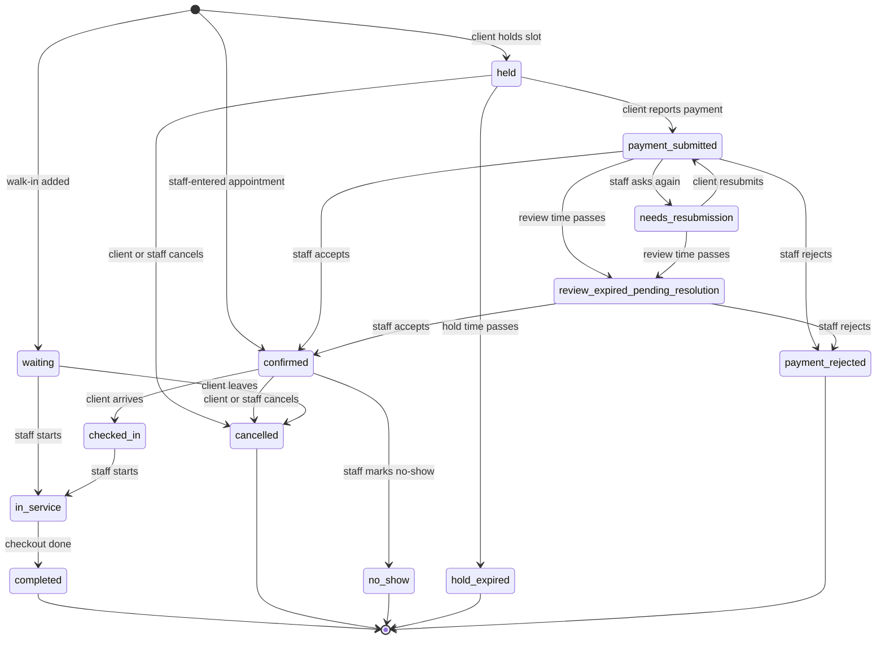

# GroomBox: app flow

Last updated: 2026-10-27
Related: [product requirements](prd.md), [technical requirements](trd.md), [design brief](design-brief.md), [backend schema](backend-schema.md)

## 1. Entry points

| Who | Arrives from | Lands on |
|---|---|---|
| Guest or client | A branch link shared in Messenger or Instagram, or a QR code in the shop | Branch booking page |
| Guest or client | An organization link | Organization page listing branches |
| Client | Opening GroomBox directly | Client home (sign-in if needed) |
| Member | Opening GroomBox directly | Floor view of their branch |
| Owner | First visit | `/sign-up`, then `/onboarding` |
| Platform admin | Opening GroomBox directly | Admin statements list |

After sign-in, a user with both a client profile and a membership lands on the shop side and can switch to the client area from the account menu. A user who signs up through `/sign-up` goes to `/onboarding`. A signed-in user with no membership lands on the client home and can reach `/onboarding` from the account menu.

## 2. Route map

### Public

| Route | Screen |
|---|---|
| `/b/:branchSlug` | Branch page: services, staff, hours, book button |
| `/b/:branchSlug/book` | Booking flow (steps below) |
| `/o/:orgSlug` | Organization page: branches |
| `/booking/:bookingCode` | Booking status, payment details, report payment |
| `/sign-in`, `/sign-up` | Sign-in for clients and members; owner sign-up |
| `/onboarding` | Create the organization and its first branch (signed-in, non-guest users) |
| `/invite/:code` | Accept a member invite |

### Client area (signed-in client)

| Route | Screen |
|---|---|
| `/home` | Upcoming bookings, quick rebook |
| `/bookings` | Upcoming and past bookings |
| `/bookings/:bookingCode` | Booking detail |
| `/explore` | Shop directory with search and filters |
| `/explore/:branchSlug` | Shop page inside the directory |
| `/profile` | Own profile |
| `/notifications` | Notification list |

### Shop side (members)

| Route | Screen | Roles |
|---|---|---|
| `/shop/:branchId/floor` | Today's queue | All |
| `/shop/:branchId/calendar` | Day and week calendar | All |
| `/shop/:branchId/deposits` | Deposits to review | Owner, manager, permitted staff |
| `/shop/:branchId/visit/:bookingId` | Visit detail and checkout | All |
| `/shop/:branchId/close` | Daily close | Owner, manager |
| `/shop/clients` | Client list and detail | Owner, manager |
| `/shop/setup/services` | Service catalogue; branch offerings and price overrides | Owner; managers for branch offerings and prices |
| `/shop/setup/staff` | Staff, shifts, commission | Owner; managers for branch assignments, shifts, and time off |
| `/shop/setup/branches` | Branches, hours, payment details | Owner |
| `/shop/setup/policies` | Deposit rule, hold and review times, cancellation policy, directory listing | Owner |
| `/shop/team` | Members and invites | Owner |
| `/shop/billing` | Fee statements and how to pay | Owner |
| `/shop/restricted` | Restriction notice | All, when restricted |

### Platform admin

| Route | Screen |
|---|---|
| `/admin/statements` | Statements across organizations |
| `/admin/statements/:id` | Statement detail, mark paid, add adjustment |
| `/admin/organizations` | Organizations, restrict or restore |
| `/admin/settings` | Fee, cut-off, grace period, statement minimum, GroomBox's payment details |

## 3. Navigation

| Surface | Phone | Tablet and desktop |
|---|---|---|
| Client area | Bottom bar: Home, Explore, Bookings, Profile | Top bar with the same items |
| Shop side | Bottom bar: Floor, Calendar, Deposits, Clients, More | Left sidebar; branch switcher at the top |
| Booking flow | Step header with back; one sticky primary button at the bottom | Same, centred in a narrow column |
| Admin | Top bar | Left sidebar |

## 4. Flow: online booking

1. **Branch page.** The client sees services grouped by category with price and duration, and taps "Book".
2. **Services.** Pick one or more. A running total and total duration show at the bottom.
3. **Staff.** Pick a staff member who performs all chosen services, or "Any available".
4. **Date and time.** Pick a date; open start times load for that date. Unavailable days are disabled.
5. **Details.** A signed-in client confirms name and mobile number. A visitor chooses "Continue as guest" (name and mobile number) or signs in.
6. **Review.** Shows services, staff, time, service total, deposit, convenience fee, amount due now, balance due at the shop, and the cancellation policy. The client ticks to accept the policy and taps "Hold my slot".
7. **Pay.** The slot is held. The screen shows a countdown, the amount due, and the branch's payment details and QR. The client pays in their own e-wallet app.
8. **Report payment.** The client enters the reference number, amount, and method, optionally attaches a screenshot, and submits.
9. **Waiting for review.** The booking page shows "Payment under review" and updates live.
10. **Result.** Confirmed, or "Please resubmit" with the shop's note, or rejected.

If the selected time is taken while the client is on step 5 or 6, the hold fails with a clear message and returns them to step 4 with fresh times.

A guest is prompted to save the booking link and offered "Create an account to track your bookings" after step 8.

## 5. Booking states

| State | Client sees | Staff sees | Slot |
|---|---|---|---|
| `held` | Countdown and payment details | "Awaiting payment" | Blocked until the hold runs out |
| `payment_submitted` | "Payment under review" | In the deposits list | Blocked |
| `needs_resubmission` | The shop's note and the form again | "Waiting for client" | Blocked |
| `review_expired_pending_resolution` | "The shop has not reviewed your payment yet. Your slot is still held." | Flagged at the top of the deposits list | Blocked |
| `confirmed` | Booking confirmed | On the calendar and floor | Blocked |
| `waiting` | Not applicable (walk-in) | In the queue | Not on the calendar until started |
| `checked_in` | Checked in | "Arrived" in the queue | Blocked |
| `in_service` | In service | "In service" | Blocked |
| `completed` | Past booking | Closed visit with sale | Historical |
| `cancelled`, `no_show`, `hold_expired`, `payment_rejected` | Final status with reason | Final status | Released |

The convenience fee entry is created on the move to `confirmed` from a deposit review, and never removed by a later state.

## 6. Flow: deposit review

1. A badge on "Deposits" shows the number waiting. Bookings flagged for resolution sort first.
2. The reviewer opens one: client, services, time, amount due, and the reported reference number, amount, method, and screenshot.
3. The reviewer checks the shop's e-wallet outside GroomBox.
4. They choose **Accept**, **Ask to resubmit** (with a note), or **Reject** (with a reason).
5. The client's booking page updates live and a notification is created.

## 7. Flow: walk-in

1. On the floor view, tap "Add walk-in".
2. Enter a name (mobile number optional), pick services, and optionally a staff member.
3. The visit joins the queue as `waiting` with a queue number.
4. When a chair is free, tap "Start" and confirm the staff member; the visit becomes `in_service` and takes a slot on the calendar from now.

## 8. Flow: visit and checkout

1. Tap a confirmed appointment and "Check in" when the client arrives.
2. Tap "Start" when service begins.
3. Tap "Checkout": the items are pre-filled from the booking. Adjust a price, add an item, apply a discount, enter a tip.
4. The screen shows the total, the deposit already paid, and the balance.
5. Record how the balance was paid, by one or more methods.
6. Tap "Complete". The visit closes, the sale and commission are stored, and the floor updates.

## 9. Flow: daily close

1. Open "Close" for the branch. The business date defaults to today.
2. The screen lists unfinished visits; each must be completed, cancelled, or marked no-show first.
3. Review totals: sales by payment method, deposits received today, discounts, tips, and commission and tips per staff member.
4. Enter the counted cash. The difference from expected cash is shown.
5. Tap "Close day". The day locks. The owner can reopen it.

## 10. Flow: owner onboarding

1. Sign up, then name the organization and choose its category.
2. Add the first branch: name, address, area, hours.
3. Add deposit payment details and a QR image.
4. Add services, or start from a template for the chosen category.
5. Add staff and their shifts.
6. Set the deposit rule and cancellation policy; defaults are prefilled.
7. Accept the terms, which include the fee rules and directory listing.
8. Publish. The screen shows the booking link and a printable QR code.

A checklist on the floor view shows any step skipped. A branch cannot be published without hours, at least one service, one bookable staff member with a shift, and payment details.

## 11. Flow: inviting a member

1. The owner opens "Team", chooses a role and branches, and creates an invite link.
2. The owner sends the link through their own chat app.
3. The invitee opens it, signs in or signs up, and joins.
4. If the member is also a bookable staff profile, the owner links the two.

## 12. Flow: fee billing

1. Each accepted deposit adds a fee entry to the organization's unbilled balance, visible under "Billing".
2. On a cut-off date, a statement is issued and the owner is notified in the app.
3. The owner opens the statement: entries, branch breakdown, total, due date, and how to pay GroomBox.
4. The owner pays outside the app and may enter a payment reference for the admin to see.
5. The platform admin checks the payment and marks the statement paid.

## 13. Flow: restriction

1. A statement passes its due date unpaid; the organization becomes restricted.
2. Any member opening the shop side is sent to the restriction notice. Staff and managers see "Ask the owner to settle the account". The owner sees the overdue statements and payment instructions.
3. Booking links keep working. New deposits wait for review.
4. The admin marks the statements paid; access returns on the next page load.

## 14. Flow: guest to account

1. A guest with a booking taps "Create an account".
2. If they are inside the Messenger or Instagram browser, the app first asks them to open the page in their phone's browser.
3. They sign in with Google or Facebook; the identity is attached to the guest session.
4. Their existing bookings appear under "Bookings".

A guest who clears their browser or changes device before upgrading can still reach a booking through its link, which carries the booking code.

## 15. Empty, loading, and error states

| Situation | Behaviour |
|---|---|
| No times on the chosen date | "No times left on this day" with the next date that has openings |
| Slot taken during booking | Message, then back to the time step |
| Hold ran out | "Your hold ran out" with "Pick a new time" |
| Offline | Banner; actions disabled until the connection returns |
| New app version | Prompt to reload |
| Branch unpublished or missing | "This shop is not taking online bookings" |
| No bookings, clients, or statements yet | Short explanation and the one action that fills the screen |
