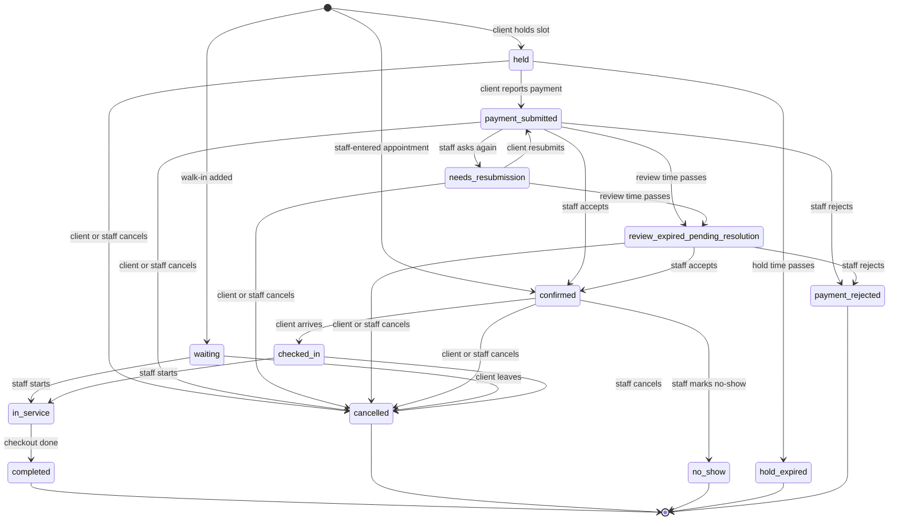

# GroomBox: app flow

Last updated: 2026-11-05
Related: [product requirements](prd.md), [technical requirements](trd.md), [design brief](design-brief.md), [backend schema](backend-schema.md)

## 1. Entry points

| Who | Arrives from | Lands on |
|---|---|---|
| Guest or client | A branch link shared in Messenger or Instagram, or a QR code in the shop | Branch booking page |
| Guest or client | An organization link | Organization page listing branches |
| Client | Opening GroomBox directly | Client home (sign-in if needed) |
| Member | Opening GroomBox directly | Floor view of their branch |
| Owner | First visit | Sign-up, then `/onboarding` |
| Platform admin | Opening GroomBox directly | Admin statements list |

After sign-in, a user with both a client profile and a membership lands on the shop side and can switch to the client area from the account menu. A member of more than one organization switches organization from the same menu (ACC-5).

## 2. Route map

### Public

| Route | Screen |
|---|---|
| `/b/:branchSlug` | Branch page: services, staff, hours, book button |
| `/b/:branchSlug/book` | Booking flow (steps below) |
| `/o/:orgSlug` | Organization page: branches |
| `/booking/:bookingCode` | Booking status, payment details, report payment. Also the booking detail for signed-in clients. Opens on any device; see "Opening a booking from its link" |
| `/sign-in`, `/sign-up` | Sign-in for clients and members; owner sign-up |
| `/invite/:code` | Accept a member invite |
| `/onboarding` | Owner's first organization and branch setup (signed-in owner with no organization) |

### Client area (signed-in client)

| Route | Screen |
|---|---|
| `/home` | Upcoming bookings, quick rebook |
| `/bookings` | Upcoming and past bookings; each opens `/booking/:bookingCode` |
| `/explore` | Shop directory with search and filters |
| `/explore/:branchSlug` | Shop page inside the directory |
| `/profile` | Own profile |
| `/notifications` | Notification list |

### Shop side (members)

| Route | Screen | Roles |
|---|---|---|
| `/shop/:branchId/floor` | Today's queue | All |
| `/shop/:branchId/calendar` | Day and week calendar | All |
| `/shop/:branchId/deposits` | Deposits to review | Owner, manager, permitted staff |
| `/shop/:branchId/visit/:bookingId` | Visit detail and checkout | All |
| `/shop/:branchId/close` | Daily close | Owner, manager |
| `/shop/:branchId/setup` | Branch hours (including past midnight), closures, photos, service offerings and price overrides, staff shifts and time off | Owner, manager |
| `/shop/clients` | Client list, with search | Owner, manager |
| `/shop/clients/:clientId` | Client detail: notes, visits, edit, merge a duplicate | Owner, manager |
| `/shop/notifications` | Notification list | All |
| `/shop/setup` | Links to the organization-wide setup screens | Owner |
| `/shop/setup/organization` | Organization name, logo, and category | Owner |
| `/shop/setup/services` | Service catalogue | Owner |
| `/shop/setup/staff` | Staff profiles, branch and service assignments, commission | Owner |
| `/shop/setup/branches` | Branches, address, business day start, payment details, publish and unpublish | Owner |
| `/shop/setup/policies` | Deposit rule, hold and review times, booking window, cancellation policy, directory listing | Owner |
| `/shop/team` | Members and invites | Owner |
| `/shop/billing` | Fee statements and how to pay | Owner |
| `/shop/restricted` | Restriction notice | All, when restricted |

### Platform admin

| Route | Screen |
|---|---|
| `/admin/statements` | Statements across organizations |
| `/admin/statements/:id` | Statement detail, mark paid, void, add adjustment |
| `/admin/organizations` | Organizations, restrict or restore |
| `/admin/settings` | Fee, cut-off, grace period, statement minimum, GroomBox's payment details |

## 3. Navigation

| Surface | Phone | Tablet and desktop |
|---|---|---|
| Client area | Bottom bar: Home, Explore, Bookings, Profile | Top bar with the same items |
| Shop side | Bottom bar: Floor, Calendar, Deposits (deposit reviewers only), Clients (owner and manager only), More | Left sidebar with the same role rules; branch switcher at the top |
| Booking flow | Step header with back; one sticky primary button at the bottom | Same, centred in a narrow column |
| Admin | Top bar | Left sidebar |

## 4. Flow: online booking

1. **Branch page.** The client sees services grouped by category with price and duration, and taps "Book".
2. **Services.** Pick one or more. A running total and total duration show at the bottom.
3. **Staff.** Pick a staff member who performs all chosen services, or "Any available".
4. **Date and time.** Pick a date, from today up to the shop's booking horizon; open start times load for that date. Unavailable days are disabled. At a branch open past midnight, times after midnight appear at the end of the opening day's list, marked with the next day, for example "1:00 AM (Sun)".
5. **Details.** A signed-in client confirms name and mobile number, prefilled from their account. A visitor chooses "Continue as guest" (name and mobile number, behind the bot check, which starts a guest session) or signs in; signing in returns to this step with the chosen services, staff, and time kept. A returning guest's session is reused.
6. **Review.** Shows services, staff, time, service total, deposit, convenience fee, amount due now, balance due at the shop, and the cancellation policy. The client ticks to accept the cancellation policy and the privacy notice (both linked) and taps "Hold my slot".
7. **Pay.** The slot is held. The screen shows a countdown, the amount due, and the branch's payment details and QR. The client pays in their own e-wallet app.
8. **Report payment.** The client enters the reference number, amount, and method, optionally attaches a screenshot, and submits.
9. **Waiting for review.** The booking page shows "Payment under review" and updates live.
10. **Result.** Confirmed, or "Please resubmit" with the shop's note, or rejected.

If the selected time is taken while the client is on step 5 or 6, the hold fails with a clear message and returns them to step 4 with fresh times.

If the hold runs out before the client reports payment, step 8 is refused: "Your hold ran out. If you already paid, contact the shop", with the shop's contact number and "Pick a new time". A session that already has two unexpired holds cannot start a third.

A guest is prompted to save the booking link and offered "Create an account to track your bookings" after step 8.

## 5. Booking states

| State | Client sees | Staff sees | Slot |
|---|---|---|---|
| `held` | Countdown and payment details | "Awaiting payment" | Blocked until the hold runs out |
| `payment_submitted` | "Payment under review" | In the deposits list | Blocked |
| `needs_resubmission` | The shop's note and the form again | "Waiting for client" | Blocked |
| `review_expired_pending_resolution` | "The shop has not reviewed your payment yet. Your slot is still held." | Flagged at the top of the deposits list | Blocked |
| `confirmed` | Booking confirmed | On the calendar and floor | Blocked |
| `waiting` | Not applicable (walk-in) | In the queue | Not on the calendar until started |
| `checked_in` | Checked in | "Arrived" in the queue | Blocked |
| `in_service` | In service | "In service" | Blocked |
| `completed` | Past booking | Closed visit with sale | Historical |
| `cancelled`, `no_show`, `hold_expired`, `payment_rejected` | Final status with reason | Final status | Released |

The convenience fee entry is created on the move to `confirmed` from a deposit review, and never removed by a later state.

Clients cancel before the start time. Cancelling a booking with a reported payment withdraws the proof; any refund is settled between the shop and the client, and a deposit reviewer records the outcome on the booking. The same applies to rejected and no-show bookings.

## 6. Flow: deposit review

1. A badge on "Deposits" shows the number waiting. Bookings flagged for resolution sort first. Reviewers get a notification when an hour of review time is left.
2. The reviewer opens one: client, services, time, amount due, and the reported reference number, amount, method, and screenshot. A reported amount that differs from the amount due is highlighted with the difference.
3. The reviewer checks the shop's e-wallet outside GroomBox.
4. They choose **Accept**, **Ask to resubmit** (with a note), or **Reject** (with a reason). Accept means the full amount due arrived; a short payment is sent back for resubmission or rejected. Asking to resubmit gives the client a fresh review time. A booking flagged for resolution offers only **Accept** or **Reject**, following the state diagram.
5. The client's booking page updates live and a notification is created.

Below the list, "Waiting for the client" shows bookings sent back for resubmission, and "Refunds to record" shows cancelled, rejected, and no-show bookings with a reported payment, where a reviewer records whether the deposit was refunded.

## 7. Flow: walk-in

1. On the floor view, tap "Add walk-in".
2. Search for an existing client by name or mobile number, or enter a new name (mobile number optional). Pick services, and optionally a staff member.
3. The visit joins the queue as `waiting` with a queue number.
4. When a chair is free, tap "Start" and confirm the staff member; the visit becomes `in_service` and takes a slot on the calendar from now.

## 8. Flow: visit and checkout

1. Tap a confirmed appointment and "Check in" when the client arrives.
2. Tap "Start" when service begins.
3. Tap "Checkout": the items are pre-filled from the booking. Adjust a price, add an item, apply a discount, and enter a tip for each staff member on the sale.
4. The screen shows the total, the deposit already paid, and the balance. If the deposit is larger than the bill, the balance is zero and the screen shows the amount to refund outside GroomBox.
5. Record how the balance was paid, by one or more methods. "Complete" stays disabled until the payments add up to the balance exactly; for cash, enter the cash received and the screen shows the change.
6. Tap "Complete". The visit closes, the sale and commission are stored, and the floor updates.

## 9. Flow: daily close

1. Open "Close" for the branch. The business date defaults to the current one, so a spa closing at 2:00 AM still closes the day it opened.
2. The screen lists the day's unfinished visits (waiting, confirmed, checked in, in service); each must be completed, cancelled, or marked no-show first. Bookings still waiting on a deposit decision do not block the close and stay in the deposits list.
3. Review totals: sales by payment method, deposits received that day, discounts, tips, commission and tips per staff member, and convenience fees collected for GroomBox (shown separately; not cash in the drawer).
4. Enter the opening float and the counted cash. Expected cash is the float plus cash sales; the difference is shown.
5. Tap "Close day". The day locks. The owner can reopen it.

## 10. Flow: owner onboarding

1. Sign up, then name the organization and choose its category.
2. Add the first branch: name, address, city, area, hours. A day's hours start at or after the start of the business day (5:00 AM unless changed) and can close after midnight ("closes next day"), up to the start of the next business day.
3. Add deposit payment details and a QR image.
4. Add services.
5. Add staff and their shifts.
6. Set the deposit rule, booking window (time between start times, minimum notice, how far ahead), and cancellation policy; defaults are prefilled.
7. Accept the terms, which include the fee rules and directory listing.
8. Publish. The screen shows the booking link and a printable QR code.

Steps 1 and 2 are saved together by `create_organization`. A checklist on the floor view shows any step skipped. The Publish button stays disabled until the branch has its address, city, and area; hours; at least one offered service; one bookable staff member with a shift; payment details with a QR image; and accepted terms (SET-10). While the branch is published, setup screens refuse to remove the last of any of these and ask the owner to unpublish first.

Unpublishing stops new online bookings; the branch page shows "This shop is not taking online bookings", and existing bookings carry on and stay reachable by their code. Deactivating a branch (ACC-2) needs the branch unpublished and no upcoming bookings.

## 11. Flow: inviting a member

1. The owner opens "Team", chooses a role and branches, and creates an invite link.
2. The owner sends the link through their own chat app.
3. The invitee opens it and sees the organization, role, and branches before signing in. They sign in or sign up, and join.
4. If the member is also a bookable staff profile, the owner links the two.

## 12. Flow: fee billing

1. Each accepted deposit adds a fee entry to the organization's unbilled balance, visible under "Billing".
2. On a cut-off date, a statement is issued and the owner is notified in the app.
3. The owner opens the statement: entries, branch breakdown, total, due date, and how to pay GroomBox.
4. The owner pays outside the app and may enter a payment reference for the admin to see.
5. The platform admin checks the payment and marks the statement paid.

## 13. Flow: restriction

1. A statement passes its due date unpaid; it becomes overdue and the organization becomes restricted.
2. Any member opening the shop side is sent to the restriction notice. Staff and managers see "Ask the owner to settle the account". The owner sees the overdue statements and GroomBox's payment instructions.
3. Booking links keep working. New deposits wait for review.
4. The admin marks the statements paid, or voids one issued in error; access returns on the next page load. If the admin restricted the organization by hand, only the admin's restore lifts it.

## 14. Flow: guest to account

1. A guest with a booking taps "Create an account".
2. If they are inside the Messenger or Instagram browser, the app first asks them to open the page in their phone's browser.
3. They sign in with Google or Facebook; the identity is attached to the guest session.
4. Their existing bookings appear under "Bookings".

A guest who clears their browser or changes device before upgrading can still reach a booking through its link, which carries the booking code (see the next section).

## 15. Opening a booking from its link

The booking code works like a key: anyone who has the link can see the booking, so the code is long and random (`7K2M-QX9D-4HTB`).

1. The page loads the booking with `get_booking_by_code`. The creator, a signed-in client who owns it, and branch members see the full page as usual.
2. Anyone else holding the link sees the status, shop, time, services, amounts, and payment details, read-only. The client's mobile number and the shop's notes never appear.
3. If the booking was made as a guest, the page offers "Manage this booking here". Tapping it makes this device's session the booking's owner, starting a guest session behind the bot check if the device has none, so the client can report payment, cancel, or create an account. The old device loses access and sees the booking read-only, like anyone with the link.
4. If the booking was made by a signed-in account, the page offers "Sign in to manage this booking" instead.

## 16. Empty, loading, and error states

| Situation | Behaviour |
|---|---|
| No times on the chosen date | "No times left on this day" with the next date that has openings |
| Slot taken during booking | Message, then back to the time step |
| Hold ran out | "Your hold ran out" with "Pick a new time" |
| Offline | Banner; actions disabled until the connection returns |
| New app version | Prompt to reload |
| Branch unpublished or missing | "This shop is not taking online bookings" |
| No bookings, clients, or statements yet | Short explanation and the one action that fills the screen |
